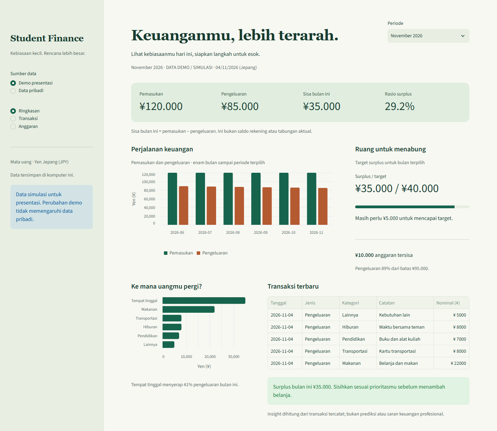

# Student Financial Dashboard

Dashboard keuangan mahasiswa berbasis **Python + Streamlit**, dengan antarmuka Indonesia dan mata uang **yen Jepang (JPY)**. Dibuat untuk belajar Python, demonstrasi kelas, dan pencatatan keuangan lokal.



## Fitur

- Ringkasan pemasukan, pengeluaran, surplus bulanan, dan rasio surplus.
- Grafik tren enam bulan dan distribusi kategori pengeluaran.
- Tambah, ubah, hapus, cari, filter, dan ekspor transaksi ke CSV.
- Anggaran bulanan dan target surplus dengan indikator progres.
- Insight sederhana berdasarkan angka tercatat, tanpa layanan AI atau API berbayar.
- Mode **Demo presentasi** dan **Data pribadi** memakai database terpisah.
- Penyimpanan SQLite lokal; perubahan tetap tersedia setelah aplikasi ditutup.
- Tata letak menyesuaikan layar desktop dan ponsel.

**Surplus bukan saldo rekening:** pemasukan dikurangi pengeluaran pada bulan terpilih. Target surplus tidak mengukur setoran atau saldo tabungan aktual. Rasio ditampilkan sebagai `—` saat pemasukan nol.

## Menjalankan proyek yang sudah disiapkan

Di VS Code, buka folder proyek lalu **Terminal > New Terminal**:

```powershell
.\.venv\Scripts\python.exe -m streamlit run app.py
```

Buka [http://127.0.0.1:8501](http://127.0.0.1:8501). Tekan **Ctrl+C** untuk berhenti. Jika aplikasi dijalankan dari proses latar oleh asisten, tutup proses tersebut sebelum memulai server baru pada port yang sama.

## Instalasi dari GitHub

Gunakan Python 3.14 dan Git:

```powershell
git clone https://github.com/doreuw98/Student-Financial-Dashboard.git
cd Student-Financial-Dashboard
python -m venv .venv
.\.venv\Scripts\python.exe -m pip install -r requirements.txt
.\.venv\Scripts\python.exe -m streamlit run app.py
```

Perintah memakai interpreter langsung sehingga tidak perlu mengubah kebijakan PowerShell atau mengaktifkan lingkungan manual. VS Code juga merekomendasikan ekstensi Python dan interpreter `.venv`.

## Panduan singkat

1. Pilih **Demo presentasi** untuk mencoba enam bulan data simulasi, atau **Data pribadi** untuk mulai kosong.
2. Pilih periode di bagian atas. Semua ringkasan, daftar transaksi dan rencana mengikuti bulan ini; grafik menampilkan enam bulan sampai periode terpilih.
3. Di **Transaksi > Tambah**, pilih jenis, tanggal, kategori dan nominal yen bulat. Transaksi masuk ke bulan sesuai tanggalnya.
4. Di **Ubah / hapus**, pilih transaksi. Penghapusan memerlukan centang konfirmasi.
5. Di **Anggaran**, simpan batas pengeluaran dan target surplus. Nilai 0 berarti belum diatur.
6. Di **Riwayat**, filter atau cari, lalu pilih **Unduh CSV** untuk mengekspor hasil yang sedang terlihat.

Data demo dibuat sekali pada saat mode demo pertama kali dibuka. Perubahan demo tersimpan, dan transaksi yang dihapus tidak muncul kembali secara otomatis.

## Struktur yang ringkas

```text
app.py                 Antarmuka, formulir, dan grafik
finance.py             SQLite, validasi, perhitungan, dan generator demo
style.css              Palet, tipografi, dan penyesuaian responsif
requirements.txt       Tiga dependensi langsung
tests/                 Pengujian penyimpanan, hitungan, dan alur antarmuka
.streamlit/config.toml Tema dan server lokal
.vscode/               Interpreter dan rekomendasi ekstensi
data/private/          Dibuat otomatis; tidak diunggah ke GitHub
```

## Pengujian

```powershell
.\.venv\Scripts\python.exe -m unittest discover -s tests -v
.\.venv\Scripts\python.exe -m pip check
```

Pengujian memakai database sementara dan tidak menyentuh data pengguna. Mencakup CRUD, validasi nominal/kategori, pemisahan bulan, persistensi rencana, demo tanpa duplikasi, pergantian halaman, mode pribadi kosong, dan simpan rencana lewat UI.

## Data dan privasi

- Catatan pribadi berada di `data/private/finance.sqlite3`, demo di `data/private/demo.sqlite3`.
- Server dibatasi ke `127.0.0.1`; aplikasi ini untuk satu pengguna lokal, tanpa login, koneksi bank, atau sinkronisasi cloud.
- Database belum terenkripsi. Backup pribadi dilakukan dengan menutup server lalu menyalin folder `data/private/` ke lokasi yang kamu kontrol; simpan terpisah dari repository.
- `.gitignore` mengecualikan database, lingkungan Python, log, `.env`, kunci, dan `secrets.toml`.
- Simpan file finansial tambahan di `data/private/`. File CSV yang diunduh ke folder lain tidak otomatis dilindungi aturan folder ini.
- Tinjau file sebelum commit. `.gitignore` tidak menghapus berkas yang sudah masuk riwayat Git.

Tidak ada data keuangan nyata yang disertakan. Screenshot dalam repository memakai data demo.

## Teknologi

Python 3.14, Streamlit, Pandas, Altair, dan SQLite bawaan Python. Font disediakan Streamlit; aplikasi tidak memerlukan pengambilan font atau gambar dari layanan pihak ketiga.

Referensi: [dokumentasi instalasi Streamlit](https://docs.streamlit.io/get-started/installation/command-line).
